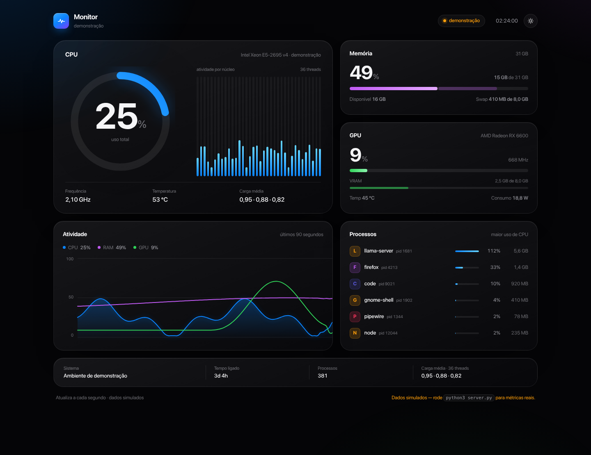
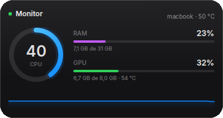

# Monitor — CPU, RAM e GPU com design Apple

Dashboard web e widget nativo do **KDE Plasma 6** para acompanhar CPU, RAM e GPU em tempo real. Visual inspirado no macOS: vidro fosco, tipografia SF/Inter, anel de atividade e animações discretas.



## Duas caras

| No navegador | Na área de trabalho |
|---|---|
| Painel completo, responsivo, com histórico de 90 s, núcleos individuais, processos e sistema. | Widget compacto com anel de CPU, RAM/GPU e mini gráfico. Clique para abrir o painel. |

<p align="center">
  
</p>

## Recursos

- **CPU** — uso total, uma barra por thread, frequência, temperatura e load average.
- **Memória** — usada, cache, disponível e swap.
- **GPU** — uso, VRAM, temperatura, consumo e clock.
  - AMD via `sysfs` (`amdgpu`)
  - NVIDIA via `nvidia-smi`
  - Sem GPU detectada, o cartão mostra “não detectada”.
- **Histórico** — últimos 90 segundos de CPU, RAM e GPU.
- **Processos** — seis maiores consumidores de CPU.
- **Tema** — claro/escuro seguindo o sistema, com alternância manual salva no navegador.
- **Widget Plasma** — instalável, redimensionável e configurável.
- **Modo demonstração** — o `index.html` sozinho mostra dados simulados, sem precisar de servidor.

## Instalação

```bash
git clone https://github.com/Oliveir4Matheus/monitor_apple_kubuntu_kde.git
cd monitor_apple_kubuntu_kde
python3 -m pip install -r requirements.txt
./install.sh
```

O `install.sh` faz duas coisas:

1. instala o widget do Plasma 6 em `~/.local/share/plasma/plasmoids/`;
2. cria e ativa o serviço de usuário `monitor.service`, que sobe junto com a sessão.

Depois abra **http://localhost:8787**.

Para rodar sem instalar nada:

```bash
python3 server.py
```

Para acessar de outro dispositivo da rede, use `http://SEU-IP:8787`. O servidor escuta em `0.0.0.0` por padrão.

## Widget do KDE

Se instalou pelo `install.sh`, ele já está disponível. Para adicionar:

**Clique com o botão direito na área de trabalho → Adicionar widgets → Monitor.**

Caso ele ainda não apareça na lista, recarregue o shell do Plasma:

```bash
systemctl --user restart plasma-plasmashell
```

Instalação manual do widget:

```bash
kpackagetool6 --type Plasma/Applet --install plasmoid
```

Configuração (botão direito no widget → **Configurar Monitor**):

- **Servidor** — endereço base do `server.py` (padrão `http://127.0.0.1:8787`).
- **Intervalo** — atualização em milissegundos (500 a 10000).

O widget consulta o servidor a cada segundo. Se o servidor cair, ele mantém os últimos valores e mostra o indicador âmbar; ao voltar, reconecta sozinho.

## Serviço manual

Se preferir não usar o `install.sh`, crie `~/.config/systemd/user/monitor.service`:

```ini
[Unit]
Description=Monitor local (CPU, RAM e GPU)
After=network-online.target

[Service]
Type=simple
WorkingDirectory=/caminho/para/monitor_apple_kubuntu_kde
ExecStart=/usr/bin/python3 -u server.py
Restart=always
RestartSec=2
Environment=PYTHONUNBUFFERED=1

[Install]
WantedBy=default.target
```

```bash
systemctl --user daemon-reload
systemctl --user enable --now monitor.service
```

Logs: `journalctl --user -u monitor -f`.

## API

O front-end e o widget consomem o mesmo endpoint:

```
GET /api/stats
```

Resposta resumida:

```json
{
  "host": "meu-pc",
  "os": "Ubuntu 26.10",
  "uptime": 11430,
  "cpu": {
    "usage": 12.4,
    "cores": [3.1, 8.0, 0.0],
    "count": 36,
    "freq": 2100,
    "temp": 48,
    "load": [1.2, 1.6, 1.9],
    "model": "Intel Xeon E5-2695 v4"
  },
  "ram": {
    "total": 33532694528,
    "used": 7873867776,
    "available": 25658826752,
    "percent": 23.5,
    "swap_total": 8589930496,
    "swap_used": 1929838592
  },
  "gpu": {
    "name": "Radeon RX 6600",
    "usage": 13,
    "vram_used": 8014745600,
    "vram_total": 8573157376,
    "temp": 43,
    "power": 11,
    "clock": 1135
  },
  "procs": [
    { "pid": 1681, "name": "llama-server", "cpu": 112.0, "mem": 6012954214 }
  ],
  "proc_count": 589
}
```

## Estrutura

```
.
├── index.html          # dashboard completo (HTML/CSS/JS puro)
├── server.py           # servidor local + API em JSON
├── install.sh          # instala widget e serviço systemd
├── requirements.txt
├── preview.png
└── plasmoid/           # widget do KDE Plasma 6 (QML)
    ├── metadata.json
    ├── preview.png
    └── contents/
        ├── config/     # configuração (servidor e intervalo)
        └── ui/         # main.qml, Ring.qml, Meter.qml, Spark.qml
```

## Compatibilidade

Testado em **Ubuntu 26.10 com KDE Plasma 6.7.5 (Wayland)**, Xeon E5-2695 v4 e Radeon RX 6600.

- O dashboard funciona em qualquer navegador moderno.
- O widget exige **KDE Plasma 6** e `kpackagetool6`.
- Em macOS o servidor roda, mas a GPU não é exposta sem ferramentas extras; o cartão fica indisponível.

## Segurança

Não há autenticação. Por padrão o servidor escuta em `0.0.0.0`, então qualquer um na mesma rede — ou no seu tailnet — consegue ver nomes de processos e uso de recursos. Para restringir à máquina local:

```bash
HOST=127.0.0.1 python3 server.py
```

Para trocar a porta:

```bash
PORT=9000 python3 server.py
```

## Licença

MIT — veja [LICENSE](LICENSE).
